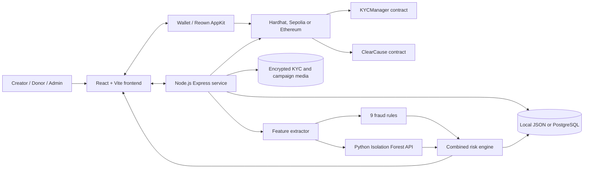
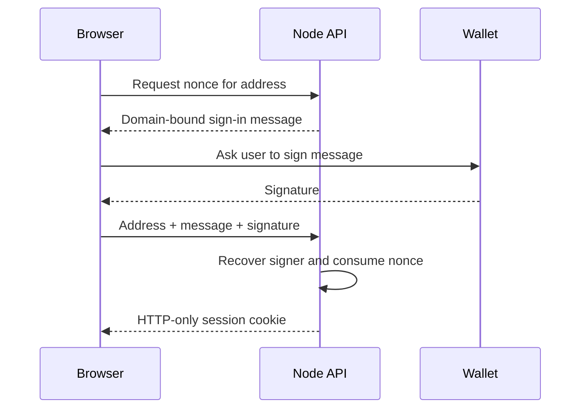
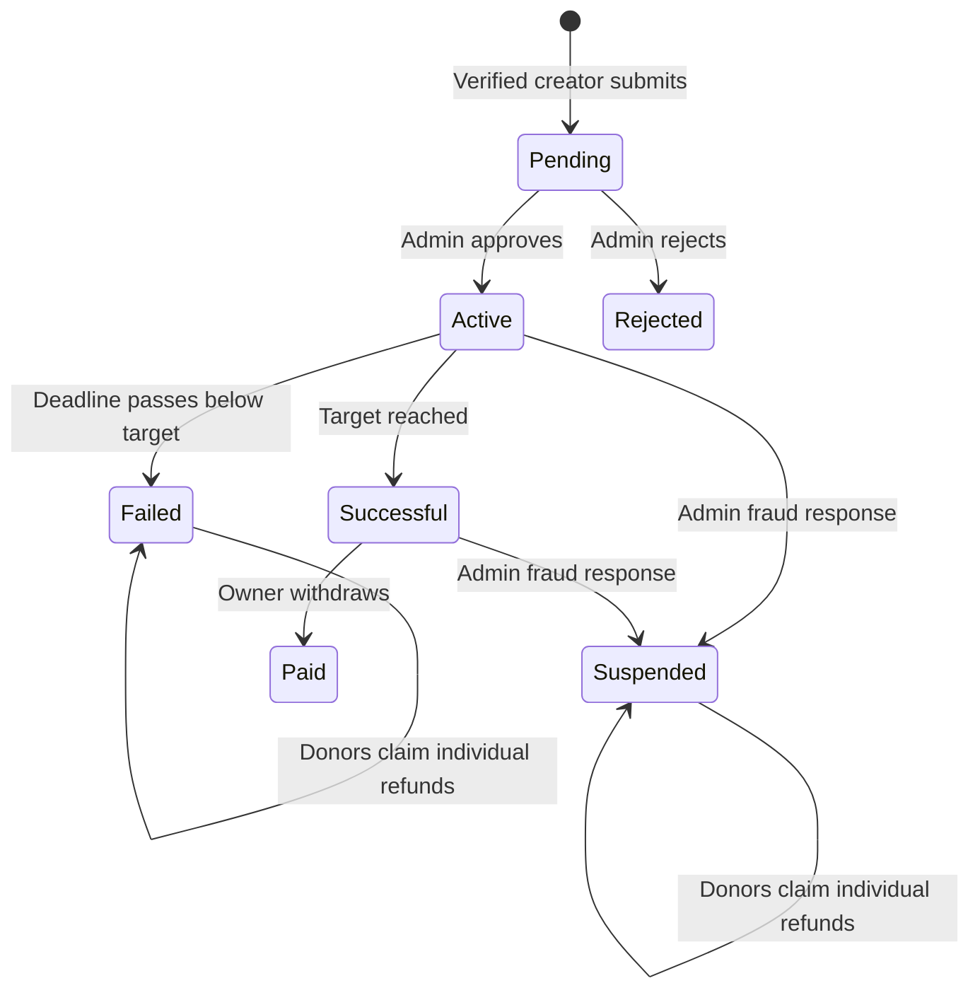
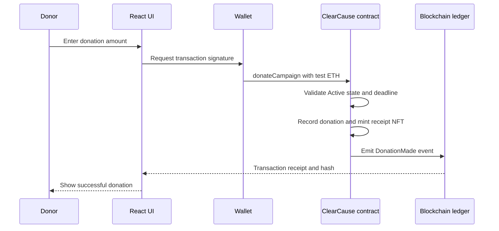
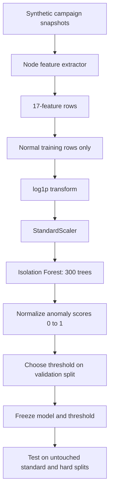
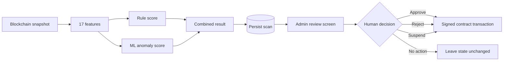
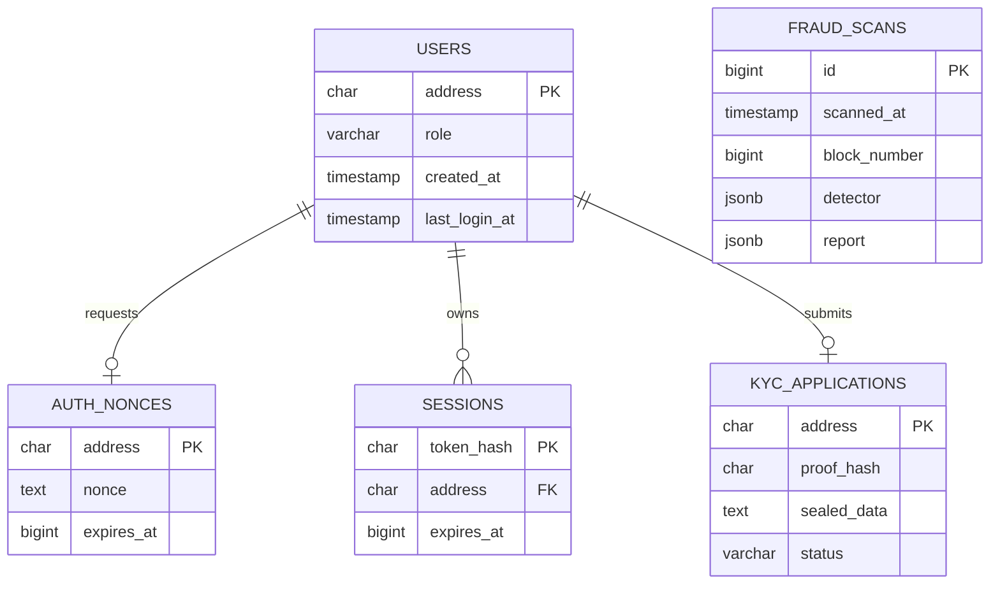
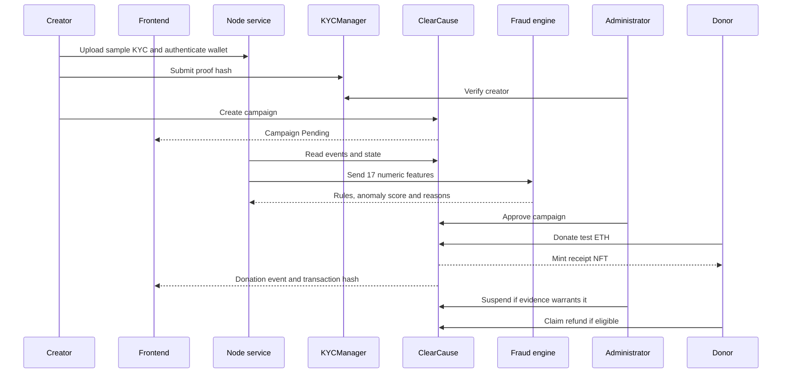

# ClearCause System Architecture

ClearCause is a transparent charity donation DApp with administrator review, wallet authentication, donation tracking,
governance, refunds, and hybrid fraud detection. It combines blockchain code with conventional web services because
not every responsibility belongs on a public blockchain.

## 1. System Goal

ClearCause is designed to make charity fundraising easier to inspect and harder to manipulate by providing:

- Public campaign and donation records.
- A transaction hash for each on-chain action.
- KYC-gated campaign creation.
- Administrator approval before fundraising starts.
- Contract-controlled donations, withdrawals and refunds.
- Donation receipt NFTs and milestone governance.
- Explainable fraud rules plus anomaly detection.
- A human decision between a fraud warning and an on-chain action.

ClearCause cannot prove that every campaign story is true. It can preserve transaction evidence, enforce programmed
rules, identify suspicious wallet behavior, and support human review.

## 2. Top-Level Architecture



## 3. Responsibility Boundaries

| Layer | Responsible for | Not responsible for |
|---|---|---|
| Frontend | Screens, forms, wallet prompts and displaying data | Authoritative financial state |
| Wallet | User identity and transaction signatures | Deciding whether a campaign is legitimate |
| Blockchain | Immutable state transitions and fund rules | Private files and computationally expensive ML |
| Node service | Private storage, authentication, chain scanning and APIs | Signing administrator transactions |
| Rule engine | Known, explainable suspicious patterns | Discovering every unknown fraud pattern |
| Isolation Forest | Unusual multivariate campaign behavior | Proving fraud or understanding campaign stories |
| Administrator | KYC and campaign decisions | Rewriting blockchain history |

## 4. Repository Map

```text
clearcause/
|-- client/                    React/Vite user interface
|   |-- src/components/       Campaign, KYC, governance and admin screens
|   |-- src/hooks/            Smart-contract and API operations
|   |-- src/abis/             Contract interfaces used by Ethers.js
|   `-- src/constant/chain.js Network and explorer configuration
|-- contract/                  Solidity and Hardhat project
|   |-- contracts/            ClearCause.sol and KYCManager.sol
|   |-- scripts/              Deployment, ABI export and local E2E scripts
|   `-- test/                 Contract behavior tests
|-- fraud/
|   |-- service/              Node.js API and fraud scanner
|   |   |-- src/features.js   Converts campaigns into 17 numeric features
|   |   |-- src/rules.js      Explainable weighted fraud rules
|   |   |-- src/scanner.js    Runs rules and optional ML
|   |   |-- src/risk.js       Combines rule and ML results
|   |   `-- db/postgres.sql   Production database schema
|   `-- ml/                   Python anomaly model
|       |-- generate_data.py  Synthetic campaign generator
|       |-- train.py          Model training and evaluation
|       |-- serve.py          Flask scoring API
|       `-- model/            Trained model, metadata and metrics
|-- start-demo.ps1            Complete Windows launcher
|-- start-demo.sh             Complete macOS/Linux launcher
|-- GUIDE.md                  Local setup and user walkthrough
`-- DEPLOYMENT.md             Hosted Sepolia deployment guide
```

## 5. Frontend Module

The active frontend starts in `client/src/main.jsx`, wraps the application in `ClearCauseProvider`, and uses React
Router. Ethers.js creates contract objects using the configured address, ABI, and either a wallet signer or read-only
provider.

Main routes:

| Route | Screen |
|---|---|
| `/` | Public charity landing page |
| `/dashboard` | User statistics and activity |
| `/dashboard/campaigns` | Campaign listing |
| `/dashboard/campaigns/:id` | Campaign details, donations and refunds |
| `/dashboard/create-campaign` | Campaign creation |
| `/dashboard/kyc` | KYC status, submission and reviewer queue |
| `/dashboard/governance` | Proposals and voting |
| `/dashboard/nfts` | Donation receipt NFTs |
| `/dashboard/admin` | Campaign and fraud review |

Reads can use the read-only RPC provider. Writes require a connected wallet signer because the user must authorize the
blockchain transaction.

## 6. Wallet Authentication and Authorization

ClearCause has two related but different authorization systems.

### Blockchain authorization

The smart contracts identify callers through `msg.sender`:

- KYCManager owner reviews KYC submissions.
- `ADMIN_ROLE` approves, rejects, suspends, pauses and unpauses campaigns.
- Campaign owners manage payout addresses, milestones and withdrawals.
- Donors holding receipt NFTs can vote.

### Backend authentication

The Node service authenticates a wallet without asking for its private key:



The backend session protects KYC uploads, campaign image uploads and manual fraud rescans. The backend does not receive
the wallet private key and does not hold an administrator signing key.

## 7. Smart Contracts

### KYCManager

`contract/contracts/KYCManager.sol` stores:

- Wallet address.
- KYC proof hash.
- Whether the user submitted KYC.
- Whether the KYC owner verified the user.
- A deduplicated queue of pending wallet addresses.

Personal fields and images stay off-chain. The proof hash is evidence connecting the backend application to the
on-chain verification record; it is not a copy of the image.

### ClearCause

`contract/contracts/ClearCause.sol` is the main application contract. It uses OpenZeppelin ERC-721, AccessControl,
Pausable and ReentrancyGuard.

Core domain models:

| Model | Purpose |
|---|---|
| `Campaign` | Owner, title, target, deadline, collected amount, image, milestones and status |
| `Proposal` | Milestone-governance proposal, votes, deadline and execution state |
| `UserStats` | Campaign, donation, proposal and reputation totals per wallet |
| `TokenData` | Campaign and donation amount represented by a receipt NFT |

Campaign states:



The contract enforces campaign duration and target bounds, KYC status, valid campaign states, access control, one-time
withdrawals, one-time refunds, voting periods, NFT-based voting and proposal quorum.

## 8. Donation and Receipt Flow



The transaction hash proves that the network accepted a specific transaction. It does not by itself prove that the
campaign description is truthful.

## 9. Governance Model

Donation receipt NFTs provide voting rights for milestone-adjustment proposals.

- A receipt NFT represents one recorded donation.
- Only eligible receipt holders can vote.
- Each receipt can be counted once per proposal.
- Transferring a receipt after voting cannot make the same receipt vote again.
- A proposal must pass its voting period, vote comparison and quorum before execution.
- Unsupported fund-allocation proposals are rejected because they have no safe execution semantics.

This is campaign governance, not a complete decentralized autonomous organization.

## 10. Node.js Service

The Express service in `fraud/service` is the off-chain backend.

It provides:

- Wallet nonce and session authentication.
- Encrypted KYC metadata and document handling.
- Campaign image uploads.
- Blockchain event scanning.
- Fraud feature extraction and scoring.
- Persistent fraud scan history.
- Public risk reads and authenticated administrator rescans.

Important endpoints:

| Endpoint | Purpose |
|---|---|
| `GET /health` | Backend, contract and ML status |
| `POST /api/auth/nonce` | Create wallet sign-in challenge |
| `POST /api/auth/verify` | Verify signature and create session |
| `POST /api/kyc/document` | Upload encrypted KYC image |
| `POST /api/kyc` | Save private KYC application metadata |
| `GET /api/risk` | Latest campaign risk results |
| `GET /api/risk/history` | Previous scan summaries |
| `GET /api/risk/:id` | Detailed campaign reasons and features |
| `POST /api/rescan` | Authenticated administrator rescan |

Local mode uses JSON files. Production mode uses PostgreSQL when `DATABASE_URL` is configured. Sensitive JSON fields
and KYC image bytes are encrypted with AES-256-GCM using `DATA_ENCRYPTION_KEY`.

## 11. Blockchain Scanner

`fraud/service/src/chain.js` is read-only. It:

1. Reads `CampaignCreated`, `CampaignApproved` and `DonationMade` events.
2. Fetches block timestamps.
3. Reads current campaign status and payout addresses from the contract.
4. Builds a plain snapshot of campaigns and donations.

Public RPC providers restrict event-query ranges, so the scanner automatically divides large ranges into smaller
chunks. It starts from the deployment block to avoid scanning the entire chain.

## 12. Fraud Feature Model

`features.js` turns each campaign into the same 17 numerical inputs used during training and live scoring:

| Feature | Meaning |
|---|---|
| `n_donations` | Total donation count |
| `n_unique_donors` | Distinct donor wallets |
| `repeat_ratio` | Donations per distinct donor |
| `raised_ratio` | Amount raised divided by target |
| `top_donor_share` | Fraction supplied by the largest donor |
| `max_single_ratio` | Largest donation divided by target |
| `cv_amount` | Variation in donation amounts |
| `top_amount_repeat_share` | Share using the most common exact amount |
| `first_hour_share` | Money received in the first hour |
| `max_burst` | Largest donation count inside ten minutes |
| `interval_cv` | Variation in time gaps; very low can look automated |
| `payout_differs` | Whether payout and creator wallets differ |
| `payout_shared_owners` | Distinct creators connected to one payout wallet |
| `owner_campaign_count` | Campaigns created by one owner |
| `owner_burst` | Same-owner campaigns created within 24 hours |
| `payout_burst` | Same-payout campaigns created within 24 hours |
| `self_donation_share` | Money donated by creator or payout wallet |

Labels such as `fraudType` are not model features.

## 13. Explainable Rule Model

`rules.js` contains nine weighted rules:

1. Creator or payout-wallet self-donation.
2. One payout wallet shared by several creators.
3. Coordinated campaign launches sharing a payout wallet.
4. Many campaigns created by one wallet within 24 hours.
5. A burst of donations inside ten minutes.
6. One donor supplying almost all funds.
7. Repeated identical amounts.
8. Machine-like regular time intervals.
9. A payout address different from the creator.

Weights reflect how suspicious a signal is and whether it has reasonable innocent explanations. Scores are capped at
100, and a rule score of 40 or more is flagged. Rules are useful because administrators can see exactly why they fired.

## 14. Isolation Forest Anomaly Model

### Why Isolation Forest

There is no established public labelled dataset of on-chain charity fraud. Isolation Forest can learn the shape of
normal numerical behavior without fitting directly to fraud labels. It is efficient for tabular data and detects unusual
combinations of features.

Alternatives such as logistic regression, Random Forest and XGBoost need representative labels. A neural network or
autoencoder would add complexity and data requirements without a demonstrated advantage for this dataset. One-Class
SVM and Local Outlier Factor are valid alternatives but are more sensitive to scaling, tuning, or production scoring
patterns.

### Training data

`generate_data.py` creates deterministic synthetic campaigns because real labelled records are unavailable. It models:

- Honest campaigns, including unusual legitimate viral bursts, large donors and pledge drives.
- Self-donation.
- Shared-payout or mule rings.
- Bot-like donation bursts.
- Structured identical donations.
- Serial campaign creation.

The generator creates separate train, validation, standard-test and hard-test splits with different random seeds, so
wallets and campaigns do not leak between splits.

### Training pipeline



`train.py` saves:

| File | Purpose |
|---|---|
| `model/isolation_forest.joblib` | Serialized preprocessing pipeline and trained Isolation Forest |
| `model/model_meta.json` | Feature order, normalization range, threshold and sklearn version |
| `model/metrics.json` | Validation and test measurements |
| `model/roc.png` | ROC comparison plot |

The current anomaly threshold is `0.6888`. `serve.py` loads the artifact and exposes `GET /health` and `POST /score`.

### Evaluation interpretation

On the generated standard test set, the model reached roughly 0.76 precision, 0.70 recall and 0.73 F1. Combining rules
and ML reached about 0.995 recall but increased false positives. Hard-test performance drops because subtle fraud and
unusual legitimate behavior overlap.

These results mean **the system detects the modelled synthetic patterns**. They do not prove real-world fraud detection.

## 15. Combined Fraud Decision



The combination is:

```text
flagged = rule engine flags OR ML flags
score   = maximum of rule score and mapped ML score
```

If the Python service is unavailable, the scanner continues with rules only. The ML service never receives private KYC
fields, never holds funds, and never signs blockchain transactions.

## 16. Persistence Model

Local development stores state under `fraud/service/data`. Production can use the tables in
`fraud/service/db/postgres.sql`:



Blockchain state remains authoritative for campaign status, donations, roles and verification. The database contains
sessions, encrypted private application records and cached analytical reports.

## 17. End-to-End Campaign Lifecycle



## 18. Security and Trust Assumptions

- Users protect their own wallet keys.
- The deployed contract code and administrator roles are publicly inspectable.
- Administrators can make review mistakes or abuse their roles; production should use multisignature administration.
- KYC data is sensitive and must use private durable storage, encryption, retention rules and authorized access.
- A fraud score is a warning, not a legal determination.
- Synthetic-model performance may not transfer to real-world behavior.
- The local Demo wallet is deliberately unsafe outside localhost.
- Real-money use requires an independent smart-contract audit and legal/privacy review.

## 19. Local and Hosted Environments

| Concern | Local demo | Hosted Sepolia demo | Real-money production |
|---|---|---|---|
| Blockchain | Resettable Hardhat | Persistent public testnet | Persistent mainnet/L2 |
| Currency | Fake local ETH | Faucet test ETH | Real funds |
| Database | Local JSON | Managed PostgreSQL | Backed-up managed database |
| Files | Local folders | Durable private storage | Audited private object storage |
| Admin | Hardhat test wallet | Test multisig recommended | Hardware-backed multisig required |
| Fraud model | Synthetic demonstration | Advisory | Requires real monitoring and retraining |
| Contract audit | Tests | Strongly recommended | Required before launch |

Read [GUIDE.md](GUIDE.md) to run the system locally and [DEPLOYMENT.md](DEPLOYMENT.md) for the hosted Sepolia plan.
