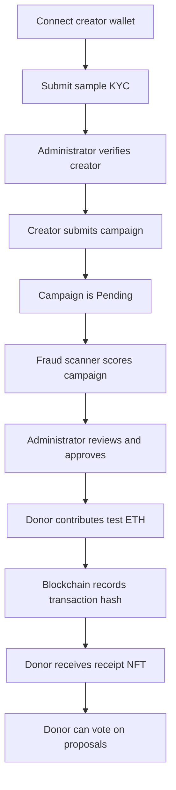

# ClearCause Local Setup Guide

This guide explains how to download, start, use, test, reset, and troubleshoot ClearCause on a local computer.
No real cryptocurrency or real identity document is required.

## 1. What ClearCause Starts

The local launcher starts four services:

| Service | Address | Purpose |
|---|---|---|
| React website | `http://127.0.0.1:5173` | User interface |
| Node.js service | `http://127.0.0.1:4000` | Authentication, uploads and fraud reports |
| Python ML service | `http://127.0.0.1:5001` | Isolation Forest anomaly scoring |
| Hardhat blockchain | `http://127.0.0.1:8545` | Local Ethereum-compatible network |

The launcher deploys fresh smart contracts and normally creates ten demonstration campaigns.

## 2. Requirements

Install these before starting:

1. **Git:** <https://git-scm.com/downloads>
2. **Node.js 20 LTS:** <https://nodejs.org>
3. **Python 3.10 or newer:** <https://www.python.org/downloads/>
4. **MetaMask:** optional for trying different wallets; the built-in Demo wallet works without it.

During Python installation on Windows, select **Add Python to PATH**.

Check the installations in PowerShell or a terminal:

```powershell
git --version
node --version
npm --version
python --version
```

Node should report version 20 or newer. If `python` is unavailable on Windows, try `py --version`.

## 3. Download the Project

Open PowerShell or a terminal in the directory where you want the project, then run:

```powershell
git clone https://github.com/nin-webapp2025/clearcause.git
cd clearcause
```

If the folder was shared as a ZIP instead, extract it and open a terminal inside the extracted `clearcause` folder.

Do not create `.env` files for the local demo. The launcher creates the required local frontend configuration.

## 4. Start Everything

### Windows

From the project root:

```powershell
powershell -ExecutionPolicy Bypass -File .\start-demo.ps1
```

### macOS or Linux

From the project root:

```bash
chmod +x start-demo.sh
./start-demo.sh
```

Install the optional ML dependencies once before the first launch:

```powershell
python -m pip install -r fraud/ml/requirements.txt
```

The first run takes longer because the launcher installs missing Node dependencies. If the Python packages were not
installed, the launcher skips the anomaly model and continues with the fraud rules. Keep the launcher terminal open
while using the application. On Windows, open:

```text
http://127.0.0.1:5173
```

On macOS or Linux, use `http://localhost:5173`. Use the hostname printed by the launcher consistently; mixing
`localhost` and `127.0.0.1` can prevent browser session cookies from being sent.

Stop the complete stack by pressing `Ctrl+C` in the launcher terminal.

## 5. Launcher Options

Windows examples:

```powershell
# Do not open a browser automatically
powershell -ExecutionPolicy Bypass -File .\start-demo.ps1 -NoBrowser

# Start with no seeded campaigns
powershell -ExecutionPolicy Bypass -File .\start-demo.ps1 -NoSeed

# Run the fraud rules without the Python model
powershell -ExecutionPolicy Bypass -File .\start-demo.ps1 -NoMl

# Enable WalletConnect with your Reown project ID
powershell -ExecutionPolicy Bypass -File .\start-demo.ps1 -ReownProjectId YOUR_ID
```

macOS/Linux equivalents are `--no-seed`, `--no-ml`, and `--reown-id YOUR_ID`.

## 6. Wallets and Accounts

### Easiest option: Demo wallet

Click **Connect wallet** and choose the local Demo wallet. It uses Hardhat's first unlocked test account. That account
is the local contract administrator and KYC reviewer.

The demo wallet and Hardhat private keys are public test fixtures. Never send real ETH to them and never reuse them on
a public blockchain.

### Optional: MetaMask

Add this network to MetaMask:

| Setting | Value |
|---|---|
| Network name | Hardhat Local |
| RPC URL | `http://127.0.0.1:8545` |
| Chain ID | `31337` |
| Currency symbol | `ETH` |

The launcher prints test accounts to `logs/chain.log`. Import only a test key from that file. The first account is the
administrator. Other accounts can act as independent creators or donors.

## 7. Recommended Demonstration Journey



### A. Submit KYC

1. Open `http://127.0.0.1:5173/dashboard/kyc`.
2. Connect the creator wallet.
3. Complete the form with fake demonstration information.
4. Upload a sample image, not a real ID document.
5. Sign the wallet authentication message and submit the on-chain proof hash.

The encrypted sample file is stored locally under `fraud/service/data/kyc-documents`. Only its proof hash and
verification status are stored on the local blockchain.

### B. Verify KYC as administrator

1. Connect the Demo wallet or first Hardhat account.
2. Return to **Verification**.
3. Review and approve the pending creator.

For a quick single-wallet demonstration, the seeded Demo wallet is already verified.

### C. Create a campaign

1. Open **Start a campaign**.
2. Enter a target of at least `0.1 ETH`.
3. Choose a deadline between 1 and 90 days from the blockchain time.
4. Upload a campaign image.
5. Submit the wallet transaction.

The campaign begins as **Pending** and cannot receive donations yet.

### D. Review and approve the campaign

1. Connect the administrator wallet.
2. Open `http://127.0.0.1:5173/dashboard/admin`.
3. Review the rule and ML risk findings.
4. Approve or reject the campaign by signing the transaction.

The fraud system only gives advice. It cannot approve, reject, suspend, or move money by itself.

### E. Donate

1. Open **Explore causes**.
2. Select an active campaign.
3. Enter a test ETH amount and donate.
4. Confirm the wallet transaction.

The interface displays the transaction hash. The contract records the donation and creates a donation receipt NFT.

### F. Try governance, suspension and refunds

- Open **Donation receipts** to see receipt NFTs.
- Open **Governance** to create or vote on a milestone-adjustment proposal.
- As administrator, suspend an active suspicious campaign.
- As a donor, claim a refund from a suspended or failed campaign when eligible.

## 8. Where Local Data Goes

| Data | Local location |
|---|---|
| Contract addresses | `contract/deployments/localhost.json` |
| Frontend settings | `client/.env` |
| User sessions and KYC metadata | `fraud/service/data/clearcause.json` |
| Encrypted KYC images | `fraud/service/data/kyc-documents` |
| Campaign images | `fraud/service/data/campaign-images` |
| Fraud scan history | `fraud/service/data/fraud-scans.json` |
| Service logs | `logs` |

These paths are ignored by Git and are not uploaded to GitHub.

## 9. Important Persistence Behavior

- Refreshing the browser does not erase blockchain data while the launcher remains running.
- Wallet connection may need to be restored by the wallet provider after a browser restart.
- Stopping and restarting `start-demo` creates a new Hardhat blockchain and redeploys the contracts.
- A fresh launcher run normally reseeds the demonstration campaigns.
- This reset behavior belongs only to local development. A Sepolia or production blockchain is persistent.

## 10. Run Tests

Smart contracts:

```powershell
cd contract
npm test
```

Node fraud service and Python model API:

```powershell
cd fraud\service
npm test
npm run test:ml
```

Frontend:

```powershell
cd client
npm run lint
npm run build
```

Return to the project root with `cd ..` as needed.

## 11. Update the Project Later

From the repository root:

```powershell
git pull
```

Stop the launcher before pulling major updates, then start it again afterward.

## 12. Troubleshooting

### PowerShell blocks the script

Use the full command:

```powershell
powershell -ExecutionPolicy Bypass -File .\start-demo.ps1
```

### A port is already in use

Stop old Node, Python, Hardhat, or launcher terminals. The required ports are `5173`, `4000`, `5001`, and `8545`.
Restart the computer if an abandoned process cannot be identified safely.

### Python model is skipped

Install its dependencies:

```powershell
python -m pip install -r fraud\ml\requirements.txt
```

Then restart the launcher. ClearCause still works with fraud rules when ML is unavailable.

### Wallet is on the wrong network

Switch MetaMask to Hardhat Local, chain ID `31337`. Do not connect a real-money wallet for local testing.

### `InvalidKYC` when creating a campaign

The connected creator address has not been verified. Submit KYC, approve it with the KYC-owner wallet, then retry with
the same creator address.

### Campaign cannot receive donations

Only **Active** campaigns accept donations. A newly created campaign must first be approved by the administrator.

### Images disappear

Confirm the Node service is running and that `fraud/service/data` has not been deleted. Local files are separate on each
computer and are intentionally not synchronized through Git.

### The website shows no campaigns

Confirm the launcher is still open. Check `logs/chain.log`, `logs/deploy.log`, `logs/fraud.log`, and `logs/web.log` for
the first reported error, then restart the full launcher.

## 13. Safety Rules

1. Use only sample KYC information and sample images.
2. Use only Hardhat test accounts locally.
3. Never commit `.env` files, private keys, database passwords, or uploaded documents.
4. Never send real ETH to local test addresses.
5. Treat fraud results as administrator guidance, not proof that a person committed fraud.

For the technical design, read [ARCHITECTURE.md](ARCHITECTURE.md). For public deployment, read
[DEPLOYMENT.md](DEPLOYMENT.md).
